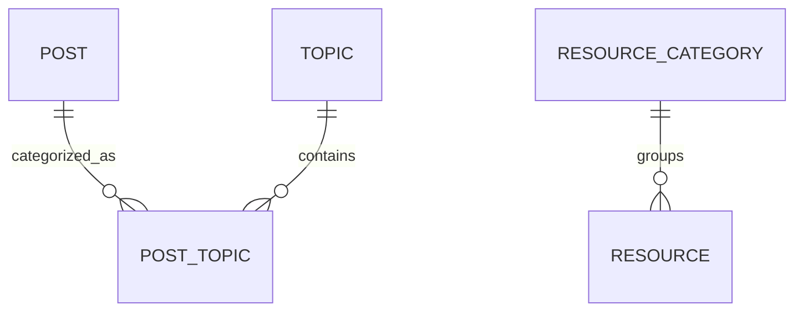

# Her Growth Diary
## Phase 3 Frontend Analysis and Proposed Database Structure

Date: 2026-10-03

## Scope

The frontend was inspected in the sibling project:

`Her Growth Diary Website Design/src/services/content.ts`

The current frontend stores content in TypeScript arrays. There is no frontend API integration yet.

## Existing Frontend Content

The frontend currently contains:

- 4 diary entries
- 6 topics
- 6 journal prompts
- 4 resource categories
- 12 resources
- Newsletter email input
- Static About page content
- Static beliefs and growth journey steps

## Proposed Relational Structure

## Proposed Models

### Post

Represents a diary article.

| Field | Type | Required | Notes |
|---|---|---:|---|
| id | UUID | Yes | Primary key |
| slug | String | Yes | Public URL identifier; unique |
| title | String | Yes | Article title |
| excerpt | String | Yes | Editorial summary shown in cards |
| content | Text | Yes | Full article body |
| coverImageUrl | String | No | External or uploaded image URL |
| coverImageAlt | String | No | Accessibility text |
| publishedAt | DateTime | No | Null while draft |
| createdAt | DateTime | Yes | Record creation time |
| updatedAt | DateTime | Yes | Last modification time |
| status | Enum | Yes | DRAFT or PUBLISHED |

Recommended indexes:

- Unique index on `slug`
- Index on `status`
- Index on `publishedAt`

The frontend `date` value should become `publishedAt`. The frontend `readTime` value, such as `5 min read`, should not be stored as a string. Reading time can be calculated from `content`.

### Topic

Represents topics such as Growth, Self-Love, Mindset, Confidence, Life, and Becoming.

| Field | Type | Required | Notes |
|---|---|---:|---|
| id | UUID | Yes | Primary key |
| slug | String | Yes | URL-safe identifier; unique |
| name | String | Yes | Display name |
| description | String | Yes | Topic description |
| sortOrder | Integer | Yes | Homepage ordering |
| createdAt | DateTime | Yes | Record creation time |
| updatedAt | DateTime | Yes | Last modification time |

The current `emoji`, `color`, and `accent` values are presentation metadata. They should remain in the frontend initially rather than storing design decisions in PostgreSQL.

### PostTopic

Join table between posts and topics.

A post may eventually belong to multiple topics, and a topic may contain multiple posts.

| Field | Type | Required |
|---|---|---:|
| postId | UUID | Yes |
| topicId | UUID | Yes |

Constraints:

- Composite primary key on `postId` and `topicId`
- Index on `topicId`
- Foreign keys to `Post` and `Topic`

The current frontend uses one category string per article, but its article categories do not exactly match its homepage topics. For example, articles use `Life & Growth` and `Personal Growth`, while homepage topics use `Life`, `Growth`, and `Becoming`. This mapping should be decided before seed data is created.

### ResourceCategory

Represents groups such as Journal Prompts, Growth Guides, Recommended Books, and Self-Reflection Exercises.

| Field | Type | Required |
|---|---|---:|
| id | UUID | Yes |
| slug | String | Yes, unique |
| name | String | Yes |
| sortOrder | Integer | Yes |
| createdAt | DateTime | Yes |
| updatedAt | DateTime | Yes |

The category emoji should remain frontend presentation data initially.

### Resource

Represents an individual resource.

| Field | Type | Required | Notes |
|---|---|---:|---|
| id | UUID | Yes | Primary key |
| categoryId | UUID | Yes | Relationship to ResourceCategory |
| title | String | Yes | Resource name |
| description | String | Yes | Resource summary |
| url | String | No | External link, if available |
| author | String | No | Useful for books |
| sortOrder | Integer | Yes | Display ordering |
| isPublished | Boolean | Yes | Controls visibility |
| createdAt | DateTime | Yes | Record creation time |
| updatedAt | DateTime | Yes | Last modification time |

The current resources have no URLs, so `url` should remain optional rather than inventing links.

### JournalPrompt

Represents a reusable reflective prompt.

| Field | Type | Required |
|---|---|---:|
| id | UUID | Yes |
| prompt | Text | Yes |
| sortOrder | Integer | Yes |
| isPublished | Boolean | Yes |
| createdAt | DateTime | Yes |
| updatedAt | DateTime | Yes |

The frontend currently has six prompt strings and no user responses. User-written journal responses should not be stored in this phase because authentication and personal user accounts are not implemented.

### NewsletterSubscriber

Represents someone who subscribes through the newsletter form.

| Field | Type | Required | Notes |
|---|---|---:|---|
| id | UUID | Yes | Primary key |
| email | String | Yes | Unique and normalized to lowercase |
| subscribedAt | DateTime | Yes | Subscription time |
| unsubscribedAt | DateTime | No | Supports unsubscribing |
| createdAt | DateTime | Yes | Record creation time |
| updatedAt | DateTime | Yes | Last modification time |

Recommended constraint:

- Unique index on normalized `email`

The subscriber table should not store passwords, authentication data, journal entries, IP addresses, browser fingerprints, or newsletter provider credentials.

## Data That Should Remain Outside the Database

These values are presentation data or derived values:

- CSS colors and accents
- Layout and card styles
- Decorative emoji
- Active search text
- Selected topic/filter state
- Featured article selection
- Previous and next article selection
- Related article selection
- Formatted reading-time strings
- The `All` filter option
- Image transformation parameters such as `w=600&h=400`

About page copy, beliefs, and growth-step illustrations should remain frontend content unless the future admin system needs to edit them.

## Existing Phase 2 Schema

The backend currently has a simple `DiaryEntry` model from Phase 2. The proposed `Post` model would replace it with a more complete editorial model. That change will require a migration and probably a data migration from `DiaryEntry` to `Post`.

No Phase 3 Prisma schema or migration should be implemented until the relational structure is approved.

## Decisions Needed Before Implementation

1. Should article categories become topics?
2. Should posts support multiple topics through `PostTopic`?
3. Should About content and growth steps become admin-editable database content?
4. Should resources support external URLs now?
5. Should `Post` be named `DiaryEntry`, `Article`, or `Post` in the backend?
